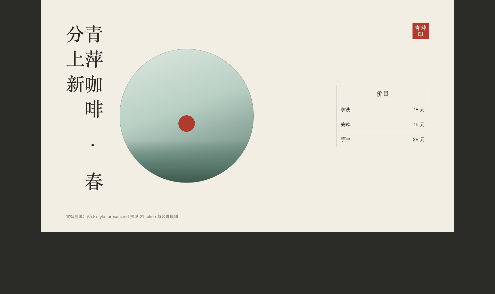
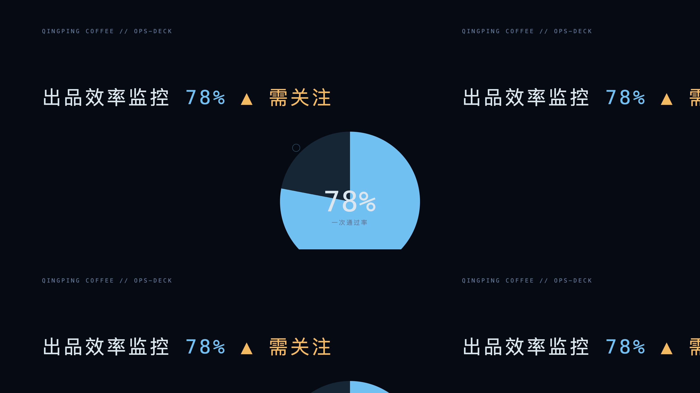

# 汇报大纲转高保真演示页 · Agent Skill

一个符合 [Agent Skills](https://github.com/anthropics/skills) 标准的开源技能：把一份文字汇报大纲，变成**视觉决策有据可查、打开即可投屏、不依赖网络**的单文件 HTML 汇报页。

核心特色：内置 **21 种可点名的设计风格预设**。用户直接说「用赛博朋克风做一版」「做成新中式」，Agent 就会套用对应的设计 token 出页，不再凭感觉发挥。

---

## 它能做什么

- 输入：Markdown / TXT 汇报大纲，或直接粘贴的文字稿（可选指定页数、受众、风格名）
- 输出：
  1. 六行设计规范表（配色 / 字体 / 字号阶梯 / 栅格 / 间距 / 组件规则）
  2. 单文件自包含 HTML 多页汇报页（16:9 投屏、键盘翻页、可打印为 PDF）
  3. 三行自检结论
- 保证：**零外部依赖**（无 CDN、无外链图片字体，断网可开）、**不编造数据**、**开箱即用无需返工**

## 21 种风格预设（点名即用）

| 布局分组 | 风格 |
|---|---|
| 左右各价（窄栏 + 大标题区） | 赛博朋克 · 复古终端 · 拟物 · 玻璃拟态 · 粗野主义 · 波普艺术 · 孟菲斯 · 杂志排版 · 瑞士风格 |
| 底下三张卡（大标题区 + 三卡） | 黏土拟态 · 新拟态 · Y2K · 像素风 · 新粗野主义 · 包豪斯 · 蒸汽波 · 极光渐变 · 装饰艺术 · 科幻 HUD |
| 特殊布局 | 便当盒布局（Bento Grid）· 新中式（竖排书法 + 月洞窗 + 印章） |

每个预设包含：配色 CSS token、字体搭配、形状语言、标志性装饰元素（如波普的 Ben-Day 网点与爆炸贴、蒸汽波的透视网格与落日条纹球）、动效规范、避坑清单。

## 效果演示（真实浏览器渲染验证）

**新中式**（竖排标题 + 月洞窗 + 印章 + 界格价目表）：



**科幻 HUD**（切角面板 + conic-gradient 仪表盘 + 等宽数据读出）：



未点名风格时，技能自动从三种默认基调（编辑部 / 工程蓝图 / 极简瑞士）中选择，并给出选择理由。

## 安装

### Claude Code / 任意支持 Agent Skills 的环境

```bash
# 方式一：克隆后把技能目录放入技能文件夹
git clone https://github.com/landawang-star/outline-to-deck-skill.git
cp -r outline-to-deck-skill ~/.claude/skills/汇报大纲转高保真演示页

# 方式二：直接下载 ZIP
# Releases 页面下载后解压到你的 skills 目录
```

### 目录结构

```
汇报大纲转高保真演示页/
├── SKILL.md                     # 主入口：YAML frontmatter + 五步工作流 + 红线
├── references/
│   ├── style-presets.md         # 21 种风格预设 token（点名即用）
│   ├── visual-system.md         # 默认基调、字体栈、字号阶梯、栅格间距、反模板黑名单
│   ├── layout-recipes.md        # 六种页型配方（封面/结论/数据/对比/流程/行动）
│   └── quality-gate.md          # 9 项交付前硬检查
└── assets/
    └── starter.html             # 页面骨架：16:9 自适应缩放、键盘翻页、打印导出
```

## 使用示例

对 Agent 说：

```text
把下面这份大纲做成汇报页，用新中式风格
---
一、封面：Q4 增长复盘
二、结论：营收增长 40%，获客成本下降 18%
三、数据：明细…
```

也可以只说触发词：

- 「把大纲做成汇报页」
- 「做个能投屏的汇报页」
- 「用赛博朋克风做一版」
- 「按便当盒布局排」
- 「这页排版太丑帮我重做」

翻页操作：方向键 / 空格 / 点击屏幕左右半区；打印为 PDF 用浏览器「打印 → 每页一张」。

## 质量保障

每份产出必须通过 `quality-gate.md` 的 9 项硬检查：

页数对齐大纲论点 · 零外部依赖 · 颜色收敛至预设 token · 字号收敛七档 · 无模板化阬工风 · 文本不溢出 · 翻页可用 · 可打印 · 事实保真（页面每个数字都能在原文找到）

## License

MIT
