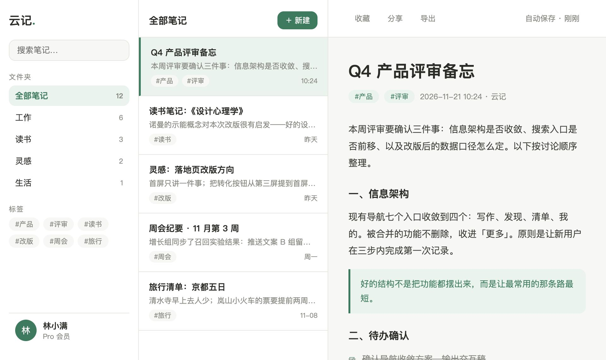
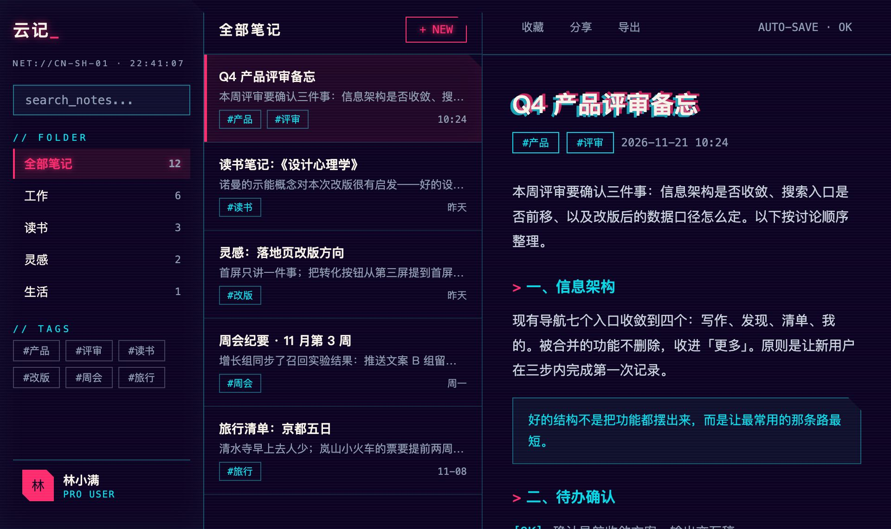
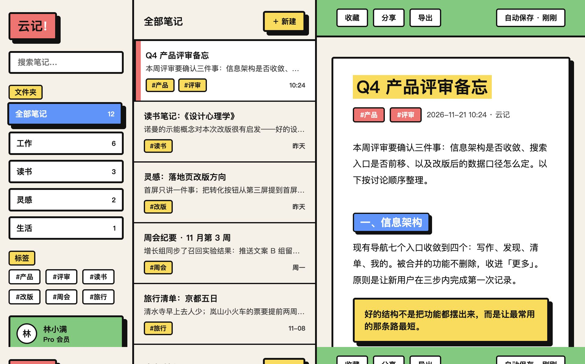
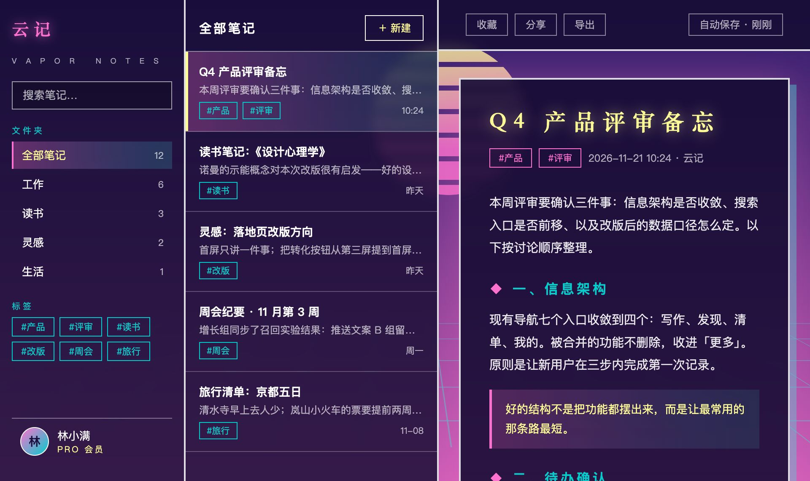
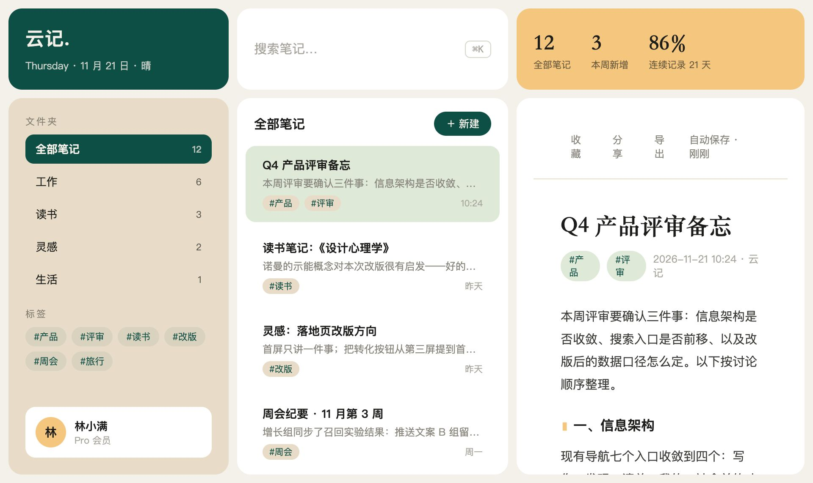
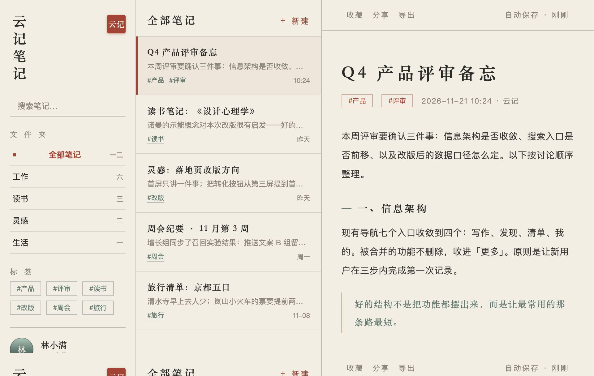

# 前端设计风格技能 · outline-to-deck-skill

一个符合 [Agent Skills](https://github.com/anthropics/skills) 标准的开源技能。

**一句话定位：这是一个「前端设计风格」技能。** 你说出一个风格名——赛博朋克、玻璃拟态、新中式、便当盒布局、蒸汽波……Agent 就按该风格**沉淀好的设计 token** 出页面，而不是凭感觉临时发挥。它让 AI 生成的前端界面从「能看」变成「有明确风格立场、且风格可复现」。

技能自带一个完整载体：把文字汇报大纲变成可直接投屏的单文件 HTML 演示页。但风格预设本身是通用的——**任何前端项目都可以套用这套风格库**，下面的真实笔记应用演示就是证明。

---

## 为什么需要这个技能

不用风格库时，AI 生成前端页面的典型问题：

| 问题 | 表现 |
|---|---|
| 风格漂移 | 说要「复古」，出来的是紫蓝渐变 + 圆角卡片 + emoji 图标的通用 AI 脸 |
| 不可复现 | 同一句「赛博朋克风」，每次生成的颜色、字体、装饰都不一样 |
| 无设计决策依据 | 说不出为什么用这个颜色、这个字号，改起来全靠猜 |
| 千页一面 | 每一页都是三张卡片并排的模板感 |

本技能的做法：**把 21 种风格的配色 token、字体搭配、形状语言、标志性装饰元素、动效、避坑清单预先写成规范**（见 [`references/style-presets.md`](references/style-presets.md)）。用户点名风格，Agent 只许用该预设的 token，不许混入其他风格的颜色和装饰。于是：

- **可复现**：同一风格名，任何人、任何 Agent 调用，产出同一套视觉决策
- **有依据**：每个颜色、圆角、装饰都能追溯到预设里的条目
- **可迁移**：预设是「皮肤」，页型是「骨架」，皮肤可以套在任何前端项目上

---

## 真实项目演示：同一个笔记应用，7 种皮肤

为了让「风格 token 可迁移」不是一句空话，我们做了一个真实的**笔记应用**（三栏布局：文件夹侧栏 / 笔记列表 / 笔记编辑器，含搜索、标签、待办清单），然后用技能里的风格预设对它做整站变换。

> [基准版](examples/note-app-baseline.html)的 DOM 结构与 5 个风格版保持一致（便当盒布局按预设规则重排格子），**变化几乎全部来自 CSS token 与装饰元素**——这正是本技能的工作方式：风格是可插拔的皮肤层。

### 基准版（未点名风格 · 干净中性）



### 赛博朋克 · Cyberpunk（预设 01）

深紫黑底 `#0D0221` + 霓虹粉/青双主色、切角边框、扫描线覆盖层、标题红青双层错位故障字、等宽数字与坐标小字。



### 玻璃拟态 · Glassmorphism（预设 04）

青绿渐变底 + 80px 模糊彩色光斑缓慢漂移，所有面板 `backdrop-filter: blur(16px)` + 1px 半透明白描边，正文落在玻璃卡片内保证对比度。


### 新粗野主义 · Neubrutalism（预设 14）

米白底 + 珊瑚红/亮蓝/柠黄高饱和色块、3px 纯黑描边、`6px 6px 0 #111` 硬阴影、hover 瞬移。注意它和「粗野主义」（黑白红、更躁）的区别在预设里已明确写出。



### 蒸汽波 · Vaporwave（预设 16）

粉紫渐变天空、条纹落日球、青色透视网格地面 20s 滚动循环；所有文字落在深色实色面板上（预设避坑条款：文字不得直接压渐变）。



### 便当盒布局 · Bento Grid（预设 20）

唯一按预设布局规则重排的版本：整页拆成 6 格大小混合的格子（品牌格 / 搜索格 / 统计大数字格 / 侧栏格 / 列表格 / 2×2 编辑大格），统一 16px 圆角、8-12px 等间距、豆绿/杏黄/奶茶/深咖色板轮换。



### 新中式 · New Chinese Style（预设 21）

宣纸米底、竖排衬线品牌字 + 朱红印章、月洞窗山水渐变头像、文件夹计数改用汉字数字、界格细线列表、大面积留白（预设要求留白 ≥ 40%）。



以上截图全部来自**真实浏览器渲染验证**（非设计稿拼贴），可直接在浏览器打开 `examples/` 下对应文件复现。

---

## 21 种风格预设（点名即用）

| # | 风格 | 别名 | 关键词 |
|---|---|---|---|
| 01 | 赛博朋克 | 霓虹、故障风 | 切角边框、扫描线、故障字 |
| 02 | 复古终端 | 绿屏、黑客终端 | 等宽、`>` 提示符、ASCII |
| 03 | 拟物 | 木纹、皮革 | 纹理、内阴影、黄铜铭牌 |
| 04 | 玻璃拟态 | 毛玻璃 | blur 玻璃板、彩色光斑 |
| 05 | 粗野主义 | 粗暴风 | 粗边硬阴影、贴纸旋转 |
| 06 | 波普艺术 | 漫画风 | Ben-Day 网点、爆炸贴 |
| 07 | 孟菲斯 | 孟菲斯几何 | 波浪线、几何碎片 |
| 08 | 杂志排版 | 报刊风 | 细线分栏、首字下沉 |
| 09 | 瑞士风格 | Helvetica 风 | 网格、左对齐、正红 |
| 10 | 黏土拟态 | 软糖风 | 24-32px 圆角、充气软块 |
| 11 | 新拟态 | 软 UI | 同色双向阴影凹凸 |
| 12 | 千禧 Y2K | Y2K | 镭射渐变、老窗口、果冻高光 |
| 13 | 像素风 | 8-bit | box-shadow 像素阶梯、step 动效 |
| 14 | 新粗野主义 | 新野兽派 | 亮色块 + 硬阴影 |
| 15 | 包豪斯 | 构成主义 | 红黄蓝几何构成 |
| 16 | 蒸汽波 | 怀旧霓虹 | 透视网格、落日条纹球 |
| 17 | 极光渐变 | 弥散光 | 深夜底、100px+ 大光斑 |
| 18 | 装饰艺术 | Art Deco | 金线对称、放射纹 |
| 19 | 科幻 HUD | 仪表盘 | 切角面板、conic 刻度环 |
| 20 | 便当盒布局 | Bento Grid | 大小格子混合、一格一事 |
| 21 | 新中式 | 国风、禅意 | 竖排、印章、月洞窗、留白 |

每个预设包含六项内容：**配色 CSS token → 字体搭配 → 形状语言 → 标志性装饰元素 → 动效规范 → 避坑清单**。例如波普艺术会告诉你网点间距必须 ≥ 4px、颜色不许超过红黄蓝粉四色；新中式会告诉你禁用饱和红金的「喜庆风」、留白不低于 40%。

---

## 技能还内置了什么

**演示载体**：把 Markdown / TXT 汇报大纲变成单文件 HTML 多页演示页——16:9 投屏、方向键翻页、可打印为 PDF、**零外部依赖**（无 CDN、无外链字体图片，断网可开）。

**六种页型配方**（[`references/layout-recipes.md`](references/layout-recipes.md)）：封面 / 结论 / 数据 / 对比 / 流程 / 行动页，避免同一页型连续出现三次。

**未点名风格时的兜底**（[`references/visual-system.md`](references/visual-system.md)）：从「编辑部 / 工程蓝图 / 极简瑞士」三种默认基调中按内容气质选择，并附反模板黑名单（紫蓝渐变、三卡片并排、emoji 图标……）。

**交付前 9 项质量门**（[`references/quality-gate.md`](references/quality-gate.md)）：页数对齐论点、零外部依赖、颜色收敛至预设 token、字号收敛七档、无模板化糙工风、文本不溢出、翻页可用、可打印、事实保真（页面每个数字都能在原文找到）。

---

## 安装

```bash
# 克隆后把技能目录放入你的技能文件夹（Claude Code 等支持 Agent Skills 的环境）
git clone https://github.com/landawang-star/outline-to-deck-skill.git
cp -r outline-to-deck-skill ~/.claude/skills/汇报大纲转高保真演示页
```

## 目录结构

```
outline-to-deck-skill/
├── SKILL.md                     # 主入口：YAML frontmatter + 五步工作流 + 红线
├── references/
│   ├── style-presets.md         # 21 种风格预设 token（点名即用）
│   ├── visual-system.md         # 默认基调、字体栈、字号阶梯、反模板黑名单
│   ├── layout-recipes.md        # 六种页型配方
│   └── quality-gate.md          # 9 项交付前硬检查
├── assets/
│   └── starter.html             # 演示页骨架：16:9 自适应缩放、键盘翻页、打印导出
├── examples/                    # ★ 真实笔记应用风格变换演示（可浏览器直接打开）
│   ├── note-app-baseline.html       # 基准版
│   ├── note-app-cyberpunk.html      # 赛博朋克
│   ├── note-app-glassmorphism.html  # 玻璃拟态
│   ├── note-app-neubrutalism.html   # 新粗野主义
│   ├── note-app-vaporwave.html      # 蒸汽波
│   ├── note-app-bento.html          # 便当盒布局
│   └── note-app-newchinese.html     # 新中式
└── docs/images/                 # 上述演示的真实浏览器截图
```

## 使用示例

对装好本技能的 Agent 说：

```text
把下面这份大纲做成汇报页，用新中式风格
---
一、封面：Q4 增长复盘
二、结论：营收增长 40%，获客成本下降 18%
三、数据：明细…
```

也可以只说触发词：

- 「把大纲做成汇报页」「做个能投屏的汇报页」
- 「用赛博朋克风做一版」「做成新中式」「套用玻璃拟态」「按便当盒布局排」
- 「这页排版太丑帮我重做」

**风格 token 用于自己的前端项目**：直接让 Agent 打开 `references/style-presets.md`，说「按预设 04 玻璃拟态的 token 改这个页面的配色和卡片样式」——就像本仓库笔记应用演示做的那样。

翻页操作：方向键 / 空格 / 点击屏幕左右半区；导出 PDF 用浏览器「打印 → 每页一张」。

## 适用边界

| 适用 | 不适用 |
|---|---|
| 有文字大纲，要立刻出可投屏的汇报页 | 要生成原生 .pptx 文件 |
| 点名某种视觉风格，要求按规范出页 | 重构现有代码库、数据分析建模 |
| 给任何前端项目套用可复现的风格 token | 要联网加载在线资源（本技能产出零外部依赖） |

## License

MIT
